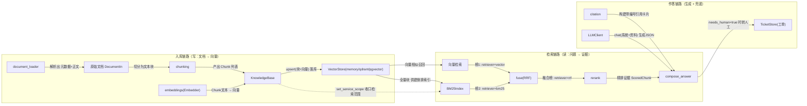

# OpsPilot

企业内部运维知识 Agent —— 面向一线运维与技术支持团队的 **Agentic RAG** 服务。

把散落在运维手册、SOP、故障复盘里的隐性知识统一入库，
通过「混合检索 + 引用溯源」回答问题；不确定时**拒答并转人工**，而不是编造操作步骤。

> 当前进度：**M3 已完成**（混合检索 + 引用溯源/拒答 + LangGraph 意图路由与建单工具）

---

## 快速开始

```bash
# 1. 安装依赖（核心链路零外部依赖，无需 Docker）
python -m pip install -e ".[dev]"

# 2. 灌入示例知识库（8 篇运维文档）
python scripts/seed.py

# 3. 启动服务
uvicorn app.main:app --port 8000
```

打开 http://127.0.0.1:8000/docs 查看交互式 API 文档。
若 docs 页面空白（Swagger 静态资源依赖公共 CDN，内网/代理环境常加载失败），
可改看 `/openapi.json`，或用 `work/_api_check.py` 脚本直接打接口。

**唯一需要你填的配置**是 `.env` 里的 `OPSPILOT_LLM_API_KEY`（DeepSeek 密钥）。
不填也能跑通 M1/M2 —— 检索链路完全不需要 LLM。

### 调用示例

```bash
curl -X POST http://127.0.0.1:8000/v1/query \
  -H "Content-Type: application/json" \
  -d '{"question": "支付服务连接池耗尽怎么处理", "top_k": 3}'
```

---

## 关于 DeepSeek 的一个重要说明

**DeepSeek 只提供对话模型，不提供 embedding 接口。** 因此本项目把两条通道完全解耦：

| 通道 | 可选来源 | 当前默认 |
|---|---|---|
| LLM | DeepSeek / OpenAI / Ollama / fallback | **DeepSeek** |
| Embedding | local 哈希向量器 / Ollama / 任意 OpenAI 兼容服务 | **local** |

默认的 `local` 是内置的特征哈希向量器：确定性、零依赖、可离线，但**不具备语义理解能力**。
这也是 M1 基线里「P1故障多久要升级」会排错的原因 —— M2 引入 BM25 + RRF 混合检索后会修正。
追求更好的语义效果时，切到 `ollama`（本地）或 `openai`（任意兼容端点）。

---

## 架构

```
FastAPI 接入层（Pydantic v2 契约 + 可选 JWT + request_id 链路追踪）
        │
        ▼
检索层：Embedding → 向量检索 ──▶ 引用构建
        │
        ▼
向量库抽象（工厂模式，可插拔）
  memory（离线/测试）  │  Qdrant（生产）  │  pgvector
```

**全链路可降级**：向量库 `qdrant → pgvector → memory`，Embedding `ollama → openai → local`，
LLM `deepseek → openai → ollama → fallback`。
`/healthz` 会**如实上报**当前实际生效的后端和所有降级原因，不会假装调用了什么。

### services 层数据流与关系

`app/services` 按「入库(写) → 检索(读) → 作答(生成)」三条链路协作，每条连线标注了实际流转的数据：



| 连线 | 流动的东西 | 含义 |
|---|---|---|
| `document_loader → DocumentIn` | `(元数据, 正文)` | 把磁盘/上传文件读成统一文档模型 |
| `chunking → KnowledgeBase` | `list[Chunk]` | 句子感知打包，`chunk_id` 内容派生保证幂等 |
| `embeddings → KnowledgeBase` | `list[list[float]]` | 按批向量化（`_embed_and_upsert`） |
| `KnowledgeBase → VectorStore` | `upsert(chunks, vectors)` | 落库，`replace` 时先删旧块 |
| `VectorStore → 向量检索` | 余弦召回 `ScoredChunk(retriever="vector")` | score 归一到 [0,1] |
| `VectorStore → BM25Index` | `all_chunks()` 全量块 | BM25 需要全量建 tf/df 表 |
| `向量检索 / BM25 → fuse` | 两路独立榜单 | RRF **只看名次不看分**，解决两路量纲不一致 |
| `fuse → rerank` | `retriever="rrf"` 融合榜 | 再用查询词覆盖率精排 |
| `rerank → compose_answer` | `retriever="rerank"` 证据 | 拼进 prompt 的 `[1][2]…` 资料 |
| `citation → compose_answer` | `Citation` 卡片 | 三层引用校验的载体 |
| `compose_answer → TicketStore` | `needs_human` 工单 | LLM 离线/解析失败时的兜底转人工 |

> 一句话概括：`KnowledgeBase` 是写入的唯一入口，`VectorStore` 是读写的交汇点，
> `ScoredChunk` 的 `retriever` 字段像接力棒一样在 `vector → rrf → rerank` 之间标记「这一分是谁给的」。

---

## API

| 方法 | 路径 | 说明 |
|---|---|---|
| GET | `/healthz` | 存活 + 实际生效的后端与降级提示 |
| GET | `/readyz` | 就绪（向量库连通、知识库非空） |
| POST | `/v1/query` | **纯检索**，不调用 LLM，用于单独衡量检索质量 |
| POST | `/v1/ask` | RAG 问答：混合检索 + LLM 生成 + 引用溯源，离线时诚实拒答 |
| POST | `/v1/agent` | **Agent 入口**：意图路由（LangGraph）→ 知识问答 / 建工单 / 闲聊 |
| POST | `/v1/documents` | 批量入库（JSON） |
| POST | `/v1/documents/upload` | 上传文件入库（md / txt / pdf） |
| GET | `/v1/documents` | 列出已入库文档 |
| DELETE | `/v1/documents/{doc_id}` | 删除文档及其全部块 |
| GET | `/v1/tickets` | 工单列表（只读，返回 `{total, items}` 信封） |
| GET | `/v1/tickets/{ticket_id}` | 工单详情（只读）；不存在返回 404 |

### `/v1/agent` 详解

LangGraph 状态图：`classify` 站先分意图（LLM 主轨，失败落关键词规则轨，`source` 字段如实申报），
再按意图分流到三个车间：`retrieve`（走 `/v1/ask` 同款检索生成链路）、
`create_ticket`（LLM 抽取工单四字段；抽取失败或离线则**兜底建单**，回答自带"（兜底建单）"标记）、
`chat`（LLM 闲聊引导；故障时落引导模板并声明原因）。
工具调用经 `tools_used` 诚实申报，降级全程可见、绝不静默。

```bash
curl -X POST http://127.0.0.1:8000/v1/agent \
  -H "Content-Type: application/json" \
  -d '{"question": "支付网关挂了，帮我建工单"}'
```

响应示例（真实链路数据，略有删节）：

```json
{
  "question": "支付网关挂了，帮我建工单",
  "answer": "已创建工单 TCK-0001：支付网关故障，需建工单处理",
  "intent": "create_ticket",
  "tools_used": ["create_ticket"],
  "citations": [],
  "refused": false,
  "needs_human": false,
  "steps": [
    {"node": "classify", "detail": "intent=create_ticket, source=llm"},
    {"node": "create_ticket", "detail": "tools=['create_ticket']"}
  ],
  "latency_ms": 2100
}
```

> `service` / `top_k` 请求参数已接入 Agent 图：`service` 在检索前经 `set_service_scope` 收口，只返回该服务标签下的文档；`top_k` 控制最终召回截断。

知识库文件支持轻量 frontmatter：

```markdown
---
title: 支付网关数据库连接池耗尽处置手册
service: pay-gateway
tags: [数据库, 连接池]
---
正文……
```

---

## 测试

```bash
python -m pytest -q
```

测试把环境钉死在 `memory + local + fallback`，**不依赖网络与密钥**，共 137 个用例。

---

## M1 检索基线（用于 M2 对比）

在 8 篇文档 / 17 个知识块上，用 local 哈希向量器：

| 指标 | 数值 |
|---|---|
| Top-1 命中 | 7 / 9 |
| Top-3 命中 | 9 / 9 |

两处 Top-1 未命中均源于哈希向量器缺乏语义理解（「P1故障多久要升级」被短块抢占）。
**这是 M2 引入 BM25 + RRF 的直接动机**，也将成为简历上的第一组对比数据。

---

## 项目结构

```
app/
  config.py              pydantic-settings 配置（DeepSeek 与 Embedding 解耦）
  models.py              Pydantic v2 数据契约
  container.py           lifespan 中的单例装配（含 LangGraph 图）
  middleware.py          request_id / 耗时 / 异常日志
  api/
    deps.py              依赖注入 + 标准库实现的 HS256 鉴权
    routes/              health / ingest / query / ask / agent / tickets
  services/
    agent.py             LangGraph 状态图（意图路由 + 三车间编排）
    intent.py            意图分类双轨（LLM 主轨 + 关键词规则兜底）
    answer.py            答案合成（引用编号 + 重试 + 拒答）
    citation.py          引用构建与校验原语
    tickets.py           工单存储（JSON 落盘，编号自增）
    chunking.py          句子感知分块（保留段落结构，支持重叠）
    embeddings.py        可插拔 Embedding + 降级
    document_loader.py   frontmatter 解析 + 多格式读取
    knowledge.py         入库编排（批量向量化 + 增量清单）
    retrieval/           bm25 / fusion(RRF) / rerank
    vector_store/        base / memory / qdrant / pgvector / factory
  utils/
    text.py              中英混合分词、无损分句、数值抽取
    logging.py           日志 + request_id 上下文
data/kb/                 8 篇示例运维知识库
scripts/seed.py          知识库灌入
tests/                   137 个用例，离线可跑
```

---

## 深挖点覆盖对照（对标大模型应用开发面试清单）

> 状态：✅ 已具备 ｜ 🟡 部分 / 进行中 ｜ 📋 规划中（见下方路线图）｜ ⛔ 暂不在范围
> 参考项目均为公开高星仓库，仅用于对照学习与选型，**不代表本项目已集成**。

**5 深入 RAG**

| 深挖点 | 状态 | 本项目落点 / 差距 | 参考项目 |
|---|---|---|---|
| 5.1 加载富文本（PDF/CSV/PPT…） | 🟡 | `document_loader.py` 支持 md/txt/pdf；缺 CSV / Excel / PPT / HTML | [infiniflow/ragflow](https://github.com/infiniflow/ragflow) |
| 5.2 多种切割器（语义 / 递归） | 🟡 | `chunking.py` 句子感知递归切分 + 重叠；缺语义切割与切割器对比 | [run-llama/llama_index](https://github.com/run-llama/llama_index) |
| 5.3 嵌入模型 + 向量库 | 🟡 | Embedding 与 LLM 解耦、可插拔；向量库 memory/Qdrant/pgvector。清单点名的 Milvus/Pinecone/ES/FAISS/Chroma 未覆盖 | [milvus-io/milvus](https://github.com/milvus-io/milvus) · [chroma-core/chroma](https://github.com/chroma-core/chroma) · [facebookresearch/faiss](https://github.com/facebookresearch/faiss) |
| 5.4 向量索引（HNSW / 倒排） | 📋 | 目前依赖现成库，尚未在代码 / 文档层讲清底层索引与选型 | [milvus-io/milvus](https://github.com/milvus-io/milvus) · [elastic/elasticsearch](https://github.com/elastic/elasticsearch) |
| 5.5 多路召回 + 粗排 / 精排 | ✅ | BM25 + RRF 融合 + 启发式 Reranker 已接入 `/v1/query`、`/v1/ask` 与 Agent 链路 | [infiniflow/ragflow](https://github.com/infiniflow/ragflow) |
| 5.6 评估（RAGAS 等） | 🟡 | `scripts/eval.py` 启发式评测（Top-1/3、MRR + 阴性对照）已建立；缺 RAGAS 类事实性指标 | [vibrantlabsai/ragas](https://github.com/vibrantlabsai/ragas) |
| 5.7 图 RAG / 多模态 RAG | 📋 | 尚无相关实现 | [microsoft/graphrag](https://github.com/microsoft/graphrag) · [HKUDS/LightRAG](https://github.com/HKUDS/LightRAG) |
| 5.8 LlamaIndex | 📋 | 目前自研检索链路，未引入 LlamaIndex | [run-llama/llama_index](https://github.com/run-llama/llama_index) |

**6 ~ 7 Agent 与新技术协议**

| 深挖点 | 状态 | 本项目落点 / 差距 | 参考项目 |
|---|---|---|---|
| 6.1 LangChain | 📋 | 代码零使用；编排直接采用 LangGraph | [langchain-ai/langchain](https://github.com/langchain-ai/langchain) |
| 6.2 LangGraph / AutoGen | ✅ | `services/agent.py`：StateGraph + 条件边意图路由 + 双轨降级（M3）；AutoGen 未涉及 | [langchain-ai/langgraph](https://github.com/langchain-ai/langgraph) · [microsoft/autogen](https://github.com/microsoft/autogen) |
| 6.3 MCP | 📋 | 未涉及，计划作为工具协议接入 | [punkpeye/awesome-mcp-servers](https://github.com/punkpeye/awesome-mcp-servers) |
| 7.1 各种范式 | 📋 | ReAct / Plan-Execute 等尚未系统化 | [huggingface/agents-course](https://github.com/huggingface/agents-course) |
| 7.2 A2A / A2UI / AGUI | 📋 | 未涉及 | [a2aproject/A2A](https://github.com/a2aproject/A2A) |
| 7.3 Function Calling | 🟡 | JSON-prompt 抽取 + `TicketIn` 契约校验 + 代码兜底的**简化版**；真 `tool_calls` 需扩展 `LLMClient`（M4） | [pguso/ai-agents-from-scratch](https://github.com/pguso/ai-agents-from-scratch) |
| 7.4 Skill | 📋 | 未涉及 | [K-Dense-AI/scientific-agent-skills](https://github.com/K-Dense-AI/scientific-agent-skills) |
| 7.5 Deep Agent | 📋 | 未涉及 | [langchain-ai/deepagents](https://github.com/langchain-ai/deepagents) |

**8 ~ 9 后训练与 Transformer（加分项）**

| 深挖点 | 状态 | 本项目落点 / 差距 | 参考项目 |
|---|---|---|---|
| 8.1 SFT / LoRA / QLoRA | ⛔ | 项目聚焦推理侧应用，不含训练 | [hiyouga/LlamaFactory](https://github.com/hiyouga/LlamaFactory) · [datawhalechina/self-llm](https://github.com/datawhalechina/self-llm) |
| 8.2 RLHF / PPO | ⛔ | 同上 | [huggingface/trl](https://github.com/huggingface/trl) |
| 8.3 DPO / GRPO | ⛔ | 同上 | [huggingface/trl](https://github.com/huggingface/trl) |
| 8.4 部署 vLLM / unsloth | 📋 | 当前仅 Ollama 本地推理，未涉及 vLLM / unsloth | [vllm-project/vllm](https://github.com/vllm-project/vllm) · [unslothai/unsloth](https://github.com/unslothai/unsloth) |
| 8.5 训练框架 DeepSpeed / LlamaFactory | ⛔ | 同上 | [deepspeedai/DeepSpeed](https://github.com/deepspeedai/DeepSpeed) |
| 9 Transformer 理解 | ⛔ | 无模型结构 / 训练相关代码或文档 | [rasbt/LLMs-from-scratch](https://github.com/rasbt/LLMs-from-scratch) · [karpathy/nanoGPT](https://github.com/karpathy/nanoGPT) |

**补齐顺序**：M3 收官 → M4（多轮对话 + 真 Function Calling）→ 按需补 MCP / A2A / 图 RAG。（参数入图于 D2、工单查询于 D3 已提前完成）

---

## 路线图

| 阶段 | 内容 | 状态 |
|---|---|---|
| M1 | 入库 + 向量检索 + `/v1/query` | ✅ 已完成 |
| M2 | BM25 + 加权 RRF + Reranker + 评测基线 | ✅ 已完成 |
| M3 | LangGraph 意图路由 + 建单工具 + `/v1/agent`（含原 M4 的引用溯源/拒答，已提前） | ✅ 已完成 |
| M4 | 多轮对话 + 真 Function Calling | 待开始 |
| M5 | CRAG 自纠正 + SSE 流式 + pgvector/部署实战 + 完整评测报告 | 待开始 |
