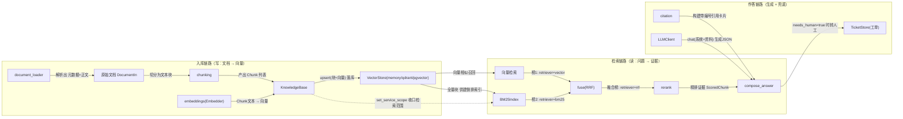

# OpsPilot

[](https://github.com/MingYao2006/OpsPilot/actions/workflows/ci.yml)

企业内部运维知识 Agent —— 面向一线运维与技术支持团队的 **Agentic RAG** 服务。

把散落在运维手册、SOP、故障复盘里的隐性知识统一入库，
通过「混合检索 + 引用溯源」回答问题；不确定时**拒答并转人工**，而不是编造操作步骤。

> 当前进度：**M4 已完成**（M3 全部 + 真 Function Calling 建单 + 无状态多轮 lite + 工单查询闭环）

---

## 快速开始

```bash
# 1. 安装依赖（核心链路零外部依赖，无需 Docker）
python -m pip install -e ".[dev]"

# 2. 灌入示例知识库（41 篇运维文档）
python scripts/seed.py

# 3. 启动服务
uvicorn app.main:app --port 8000
```

打开 http://127.0.0.1:8000/docs 查看交互式 API 文档。
若 docs 页面空白（Swagger 静态资源依赖公共 CDN，内网/代理环境常加载失败），
可改看 `/openapi.json`，或用 `work/_api_check.py` 脚本直接打接口。

**唯一需要你填的配置**是 `.env` 里的 `OPSPILOT_LLM_API_KEY`（DeepSeek 密钥）。
不填也能跑通 M1/M2 —— 检索链路完全不需要 LLM。

### 调用示例

```bash
curl -X POST http://127.0.0.1:8000/v1/query \
  -H "Content-Type: application/json" \
  -d '{"question": "支付服务连接池耗尽怎么处理", "top_k": 3}'
```

---

## 关于 DeepSeek 的一个重要说明

**DeepSeek 只提供对话模型，不提供 embedding 接口。** 因此本项目把两条通道完全解耦：

| 通道 | 可选来源 | 当前默认 |
|---|---|---|
| LLM | DeepSeek / OpenAI / Ollama / fallback | **DeepSeek** |
| Embedding | local 哈希向量器 / Ollama / 任意 OpenAI 兼容服务 | **local** |

默认的 `local` 是内置的特征哈希向量器：确定性、零依赖、可离线，但**不具备语义理解能力**。
这也是 M1 基线里「P1故障多久要升级」会排错的原因 —— M2 引入 BM25 + RRF 混合检索后会修正。
追求更好的语义效果时，切到 `ollama`（本地）或 `openai`（任意兼容端点）。

---

## 架构

```
FastAPI 接入层（Pydantic v2 契约 + 可选 JWT + request_id 链路追踪）
        │
        ▼
检索层：Embedding → 向量检索 ──▶ 引用构建
        │
        ▼
向量库抽象（工厂模式，可插拔）
  memory（离线/测试）  │  Qdrant（生产）  │  pgvector
```

**分级降级**：向量库按配置选一（`qdrant` / `pgvector` / `memory`），不可用时落到 `memory`；
Embedding 选一（`ollama` / `openai` / `local`），远端不可用时落到 `local`；LLM 未就绪则整条生成链降级为拒答。
注意这是**「选一 + 离线兜底」**，不是逐级回退的多级级联：配置了 qdrant 就不会自动再试 pgvector。
`/healthz` 会**如实上报**当前实际生效的后端和所有降级原因，不会假装调用了什么。

### services 层数据流与关系

`app/services` 按「入库(写) → 检索(读) → 作答(生成)」三条链路协作，每条连线标注了实际流转的数据：



| 连线 | 流动的东西 | 含义 |
|---|---|---|
| `document_loader → DocumentIn` | `(元数据, 正文)` | 把磁盘/上传文件读成统一文档模型 |
| `chunking → KnowledgeBase` | `list[Chunk]` | 句子感知打包，`chunk_id` 内容派生保证幂等 |
| `embeddings → KnowledgeBase` | `list[list[float]]` | 按批向量化（`_embed_and_upsert`） |
| `KnowledgeBase → VectorStore` | `upsert(chunks, vectors)` | 落库，`replace` 时先删旧块 |
| `VectorStore → 向量检索` | 余弦召回 `ScoredChunk(retriever="vector")` | score 归一到 [0,1] |
| `VectorStore → BM25Index` | `all_chunks()` 全量块 | BM25 需要全量建 tf/df 表 |
| `向量检索 / BM25 → fuse` | 两路独立榜单 | RRF **只看名次不看分**，解决两路量纲不一致 |
| `fuse → rerank` | `retriever="rrf"` 融合榜 | 再用查询词覆盖率精排 |
| `rerank → compose_answer` | `retriever="rerank"` 证据 | 拼进 prompt 的 `[1][2]…` 资料 |
| `citation → compose_answer` | `Citation` 卡片 | 引用校验的载体（`verify_answer` 逐句比对） |
| `compose_answer → TicketStore` | `needs_human` 工单 | LLM 离线 / 解析失败 / **引用校验未通过**时的兜底转人工 |

> 一句话概括：`KnowledgeBase` 是写入的唯一入口，`VectorStore` 是读写的交汇点，
> `ScoredChunk` 的 `retriever` 字段像接力棒一样在 `vector → rrf → rerank` 之间标记「这一分是谁给的」。

---

## API

| 方法 | 路径 | 说明 |
|---|---|---|
| GET | `/healthz` | 存活 + 实际生效的后端与降级提示 |
| GET | `/readyz` | 就绪（向量库连通、知识库非空） |
| POST | `/v1/query` | **纯检索**，不调用 LLM，用于单独衡量检索质量 |
| POST | `/v1/ask` | RAG 问答：混合检索 + LLM 生成 + 引用溯源，离线时诚实拒答 |
| POST | `/v1/agent` | **Agent 入口**：意图路由（LangGraph）→ 知识问答 / 建工单 / 闲聊 |
| POST | `/v1/documents` | 批量入库（JSON） |
| POST | `/v1/documents/upload` | 上传文件入库（md / txt / pdf） |
| GET | `/v1/documents` | 列出已入库文档 |
| DELETE | `/v1/documents/{doc_id}` | 删除文档及其全部块 |
| GET | `/v1/tickets` | 工单列表（只读，返回 `{total, items}` 信封） |
| GET | `/v1/tickets/{ticket_id}` | 工单详情（只读）；不存在返回 404 |

### `/v1/agent` 详解

LangGraph 状态图：`classify` 站先分意图（LLM 主轨，失败落关键词规则轨，`source` 字段如实申报），
再按意图分流到三个车间：`retrieve`（走 `/v1/ask` 同款检索生成链路）、
`create_ticket`（真 Function Calling：`chat_with_tools` 走 `tool_calls` 抽四字段；逐级退回 JSON-prompt、再退回**兜底建单**，回答自带"（兜底建单）"标记）、
`chat`（LLM 闲聊引导；故障时落引导模板并声明原因）。
工具调用经 `tools_used` 诚实申报，降级全程可见、绝不静默。

### 引用校验：把"绝不编造"从提示词变成代码

提示词里写「绝不编造操作步骤」只是**请求**，模型不遵守时没有任何后果。
`app/services/citation.py` 的 `verify_answer` 把这句话变成可执行的判定，
在 `compose_answer` 里对每一条 LLM 答复强制执行：

| 检查 | 判据 | 为什么 |
|---|---|---|
| 数字一致性 | 答案里的数字必须出现在被引原文中（`[n]` 标记不算数字） | 运维场景下编造阈值代价最高 |
| 引用存在性 | 正文引用的 `[n]` 必须真实存在 | 防止指向不存在的来源 |
| 句子支撑度 | 支撑度低于 `min_citation_support` 的句子占比不得超过一半 | 防止大段无据可依的发挥 |

未通过时**不直接拒答**，而是把失败原因回灌给模型重试（`llm_max_retries` 次），
给它改正的机会；仍不通过才转人工，并在答复里说明原因。
开关为 `OPSPILOT_VERIFY_CITATIONS`（默认开），关掉即可对比"裸生成"的差别。

> 一个实现细节：抽取数字前必须先摘掉 `[1]` 这类引用标记，
> 否则标记里的 1 会被当成编造的数字，每条带引用的答案都会误报。

```bash
curl -X POST http://127.0.0.1:8000/v1/agent \
  -H "Content-Type: application/json" \
  -d '{"question": "支付网关挂了，帮我建工单"}'
```

响应示例（真实链路数据，略有删节）：

```json
{
  "question": "支付网关挂了，帮我建工单",
  "answer": "已创建工单 TCK-0001：支付网关故障，需建工单处理",
  "intent": "create_ticket",
  "tools_used": ["create_ticket"],
  "citations": [],
  "refused": false,
  "needs_human": false,
  "steps": [
    {"node": "classify", "detail": "intent=create_ticket, source=llm"},
    {"node": "create_ticket", "detail": "tools=['create_ticket']"}
  ],
  "latency_ms": 2100
}
```

> `service` / `top_k` 请求参数已接入 Agent 图：`service` 在检索前经 `set_service_scope` 收口，只返回该服务标签下的文档；`top_k` 控制最终召回截断。
>
> 请求体可带 `history`（`list[str]`，无状态多轮 lite）：`retrieve` / `chat` 会把最近 6 轮渲染成「【对话历史】」前缀注入提示词，`create_ticket` 不注入以防串单。

知识库文件支持轻量 frontmatter：

```markdown
---
title: 支付网关数据库连接池耗尽处置手册
service: pay-gateway
tags: [数据库, 连接池]
---
正文……
```

---

## 测试

```bash
python -m pytest -q
```

测试把环境钉死在 `memory + local + fallback`，**不依赖网络与密钥**，共 254 个用例（已由 GitHub Actions CI 在 py3.11 / py3.12 双版本自动把关）。
其中 pgvector / Qdrant 两套后端用**替身 client** 覆盖适配逻辑（payload 编解码、过滤下推、表名注入防护、维度校验），不需要真服务即可在 CI 运行。

---

## 评测

```bash
python scripts/eval.py          # 固定离线配置（默认，可复现）
python scripts/eval.py --live   # 按本机 .env 的真实后端评测
```

30 条用例分四类，覆盖检索鲁棒性与诚实拒答能力（41 篇文档 / 130 个知识块）：

| 类别 | 用例数 | 混合 Top-1 | 混合+精排 Top-1 | 混合 Top-3 | 混合+精排 Top-3 |
|---|---|---|---|---|---|
| 正面（精确查询） | 15 | 13/15 | 13/15 | 15/15 | 15/15 |
| 同义换词 | 6 | 4/6 | 4/6 | 4/6 | 5/6 |
| 跨文档 OR | 3 | 2/3 | 2/3 | 3/3 | 3/3 |
| 阴性对照（应拒答） | 6 | 6/6 | 6/6 | 6/6 | 6/6 |
| **总计** | **30** | **25/30** | **25/30** | **28/30** | **29/30** |

### 检索链路消融（24 条正例）

只报总分会掩盖"哪一段真正起作用"。逐段消融如下：

| 链路 | 离线（哈希向量）Top-1 / MRR | 真实语义向量（BGE-M3）Top-1 / MRR |
|---|---|---|
| 纯向量 | 17/24 · 0.812 | 18/24 · 0.826 |
| 纯 BM25 | 19/24 · 0.875 | 19/24 · 0.875 |
| 向量 + BM25（RRF） | 19/24 · 0.854 | **19/24 · 0.868** |
| 再加精排 | 19/24 · 0.868 | 19/24 · 0.868 |

**结论**：混合检索在真实语义向量下相对纯向量有增益（Top-1 18→19、MRR 0.826→0.868）；
两路各自的强弱随语料与向量质量变化，BM25 在本语料上单独就很强——这与"术语密集的中文运维文档"相符。

### 精排从「负增益」改成「不拖后腿」

初版精排只用**查询覆盖率**单信号重排，实测在真实语义向量下是负增益
（Top-1 23→21、MRR 0.979→0.938）：覆盖率与 BM25 同属词面信号，在已有语义向量时
是重复信息，且系统性偏爱"含更多查询词"的长块，把"短而准"的块挤到后面。

现改为**归一化加权融合**（覆盖率与 RRF 分各自 min-max 归一后加权，`rerank_cov_weight` 可调）：
保留粗排的共识信息，只让覆盖率做微调。权重 0 等价于不精排，权重 1 即旧行为——
这样"精排是否值得开"变成一个可测量的旋钮，而不是信仰。

### 评测口径的两个坑（都已修，并加了自检）

1. **量纲不匹配会让阴性对照恒真。** 混合检索的输出分是 RRF 倒数排名分，
   两路融合的理论上限只有 `2/(k+1) ≈ 0.0328`；而 `min_relevance=0.06` 是按
   余弦相似度量纲定的。拿 0.06 去卡 0.0328 的分，`all(score < 0.06)` 恒为真，
   阴性对照永远"通过"——这个刹车形同虚设。
   现在改用**量纲无关**的判据：查询内容词被命中块覆盖的比例。
2. **评测必须可复现。** 原先 `eval.py` 直接继承 `.env`，本机指向 pgvector + 远端
   embedding 时，同一份代码会跑出不同数字（实测 21/24 vs 23/24）。现在默认钉死在
   离线配置，需要真实配置时显式 `--live`。

`eval.py` 结束时会做**可分离性自检**：阳性最低覆盖率与阴性最高覆盖率之间必须存在
空隙且阈值落在其中，否则以非零码退出。当前空隙为 `(0.111, 0.250)`，阈值 `0.18`。

> **阈值必须随语料重新标定。** 29 块语料时阴性最高覆盖率仅 0.000（负例太"干净"），
> 扩到 130 块后升到 0.111——语料越大，无关查询越容易蹭到部分词面重合。
> 这正是自检存在的意义：否则阈值会悄悄失效而无人察觉。

> M1 纯向量基线：Top-1 7/9、Top-3 9/9（仅正面 9 题、无阴性对照）。
> M2 引入 BM25+RRF；D7 扩到 30 题四维覆盖并补上真正可触发的阴性对照。

---

## 项目结构

```
app/
  config.py              pydantic-settings 配置（DeepSeek 与 Embedding 解耦）
  models.py              Pydantic v2 数据契约
  container.py           lifespan 中的单例装配（含 LangGraph 图）
  middleware.py          request_id / 耗时 / 异常日志
  api/
    deps.py              依赖注入 + 标准库实现的 HS256 鉴权
    routes/              health / ingest / query / ask / agent / tickets
  services/
    agent.py             LangGraph 状态图（意图路由 + 三车间编排）
    intent.py            意图分类双轨（LLM 主轨 + 关键词规则兜底）
    answer.py            答案合成（引用编号 + 重试 + 拒答）
    citation.py          引用构建与校验（verify_answer 三层判定）
    tickets.py           工单存储（JSON 落盘 + 跨进程文件锁 + 原子写）
    chunking.py          句子感知分块（保留段落结构，支持重叠）
    embeddings.py        可插拔 Embedding + 降级
    document_loader.py   frontmatter 解析 + 多格式读取
    knowledge.py         入库编排（批量向量化 + 增量清单）
    retrieval/           bm25 / fusion(RRF) / rerank(加权融合)
    vector_store/        base / memory / qdrant / pgvector / factory
  utils/
    text.py              中英混合分词、无损分句、数值抽取
    logging.py           日志 + request_id 上下文
    filelock.py          跨进程文件锁（Windows msvcrt / POSIX fcntl）
data/kb/                 41 篇示例运维知识库（130 个块）
scripts/seed.py          知识库灌入
tests/                   254 个用例，离线可跑
```

---

## 深挖点覆盖对照（对标大模型应用开发面试清单）

> 状态：✅ 已具备 ｜ 🟡 部分 / 进行中 ｜ 📋 规划中（见下方路线图）｜ ⛔ 暂不在范围
> 参考项目均为公开高星仓库，仅用于对照学习与选型，**不代表本项目已集成**。

**5 深入 RAG**

| 深挖点 | 状态 | 本项目落点 / 差距 | 参考项目 |
|---|---|---|---|
| 5.1 加载富文本（PDF/CSV/PPT…） | 🟡 | `document_loader.py` 支持 md/txt/pdf；缺 CSV / Excel / PPT / HTML | [infiniflow/ragflow](https://github.com/infiniflow/ragflow) |
| 5.2 多种切割器（语义 / 递归） | 🟡 | `chunking.py` 句子感知递归切分 + 重叠；缺语义切割与切割器对比 | [run-llama/llama_index](https://github.com/run-llama/llama_index) |
| 5.3 嵌入模型 + 向量库 | 🟡 | Embedding 与 LLM 解耦、可插拔；向量库 memory/Qdrant/pgvector。清单点名的 Milvus/Pinecone/ES/FAISS/Chroma 未覆盖 | [milvus-io/milvus](https://github.com/milvus-io/milvus) · [chroma-core/chroma](https://github.com/chroma-core/chroma) · [facebookresearch/faiss](https://github.com/facebookresearch/faiss) |
| 5.4 向量索引（HNSW / 倒排） | 📋 | 目前依赖现成库，尚未在代码 / 文档层讲清底层索引与选型 | [milvus-io/milvus](https://github.com/milvus-io/milvus) · [elastic/elasticsearch](https://github.com/elastic/elasticsearch) |
| 5.5 多路召回 + 粗排 / 精排 | ✅ | BM25 + RRF 融合 + 启发式 Reranker 已接入 `/v1/query`、`/v1/ask` 与 Agent 链路 | [infiniflow/ragflow](https://github.com/infiniflow/ragflow) |
| 5.6 评估（RAGAS 等） | 🟡 | `scripts/eval.py` 启发式评测（Top-1/3、MRR + 可触发的阴性对照 + 可分离性自检）已建立；缺 RAGAS 类事实性指标 | [vibrantlabsai/ragas](https://github.com/vibrantlabsai/ragas) |
| 5.7 图 RAG / 多模态 RAG | 📋 | 尚无相关实现 | [microsoft/graphrag](https://github.com/microsoft/graphrag) · [HKUDS/LightRAG](https://github.com/HKUDS/LightRAG) |
| 5.8 LlamaIndex | 📋 | 目前自研检索链路，未引入 LlamaIndex | [run-llama/llama_index](https://github.com/run-llama/llama_index) |

**6 ~ 7 Agent 与新技术协议**

| 深挖点 | 状态 | 本项目落点 / 差距 | 参考项目 |
|---|---|---|---|
| 6.1 LangChain | 📋 | 代码零使用；编排直接采用 LangGraph | [langchain-ai/langchain](https://github.com/langchain-ai/langchain) |
| 6.2 LangGraph / AutoGen | ✅ | `services/agent.py`：StateGraph + 条件边意图路由 + 双轨降级（M3）；AutoGen 未涉及 | [langchain-ai/langgraph](https://github.com/langchain-ai/langgraph) · [microsoft/autogen](https://github.com/microsoft/autogen) |
| 6.3 MCP | 📋 | 未涉及，计划作为工具协议接入 | [punkpeye/awesome-mcp-servers](https://github.com/punkpeye/awesome-mcp-servers) |
| 7.1 各种范式 | 📋 | ReAct / Plan-Execute 等尚未系统化 | [huggingface/agents-course](https://github.com/huggingface/agents-course) |
| 7.2 A2A / A2UI / AGUI | 📋 | 未涉及 | [a2aproject/A2A](https://github.com/a2aproject/A2A) |
| 7.3 Function Calling | ✅ | 真 OpenAI `tool_calls` 建单（`LLMClient.chat_with_tools`）+ 三级降级（真FC→JSON-prompt→硬兜底），降级全程日志可见 | [pguso/ai-agents-from-scratch](https://github.com/pguso/ai-agents-from-scratch) |
| 7.4 Skill | 📋 | 未涉及 | [K-Dense-AI/scientific-agent-skills](https://github.com/K-Dense-AI/scientific-agent-skills) |
| 7.5 Deep Agent | 📋 | 未涉及 | [langchain-ai/deepagents](https://github.com/langchain-ai/deepagents) |

**8 ~ 9 后训练与 Transformer（加分项）**

| 深挖点 | 状态 | 本项目落点 / 差距 | 参考项目 |
|---|---|---|---|
| 8.1 SFT / LoRA / QLoRA | ⛔ | 项目聚焦推理侧应用，不含训练 | [hiyouga/LlamaFactory](https://github.com/hiyouga/LlamaFactory) · [datawhalechina/self-llm](https://github.com/datawhalechina/self-llm) |
| 8.2 RLHF / PPO | ⛔ | 同上 | [huggingface/trl](https://github.com/huggingface/trl) |
| 8.3 DPO / GRPO | ⛔ | 同上 | [huggingface/trl](https://github.com/huggingface/trl) |
| 8.4 部署 vLLM / unsloth | 📋 | 当前仅 Ollama 本地推理，未涉及 vLLM / unsloth | [vllm-project/vllm](https://github.com/vllm-project/vllm) · [unslothai/unsloth](https://github.com/unslothai/unsloth) |
| 8.5 训练框架 DeepSpeed / LlamaFactory | ⛔ | 同上 | [deepspeedai/DeepSpeed](https://github.com/deepspeedai/DeepSpeed) |
| 9 Transformer 理解 | ⛔ | 无模型结构 / 训练相关代码或文档 | [rasbt/LLMs-from-scratch](https://github.com/rasbt/LLMs-from-scratch) · [karpathy/nanoGPT](https://github.com/karpathy/nanoGPT) |

**补齐顺序**：M4 收官（真 Function Calling + 多轮 lite + 工单查询）→ M5（pgvector 真库 + JWT 真鉴权 + 在线验收）→ 按需补 MCP / A2A / 图 RAG。（参数入图于 D2、工单查询于 D3、真FC于 D4、多轮 lite 于 D5 已提前完成）

---

## 路线图

| 阶段 | 内容 | 状态 |
|---|---|---|
| M1 | 入库 + 向量检索 + `/v1/query` | ✅ 已完成 |
| M2 | BM25 + 加权 RRF + Reranker + 评测基线 | ✅ 已完成 |
| M3 | LangGraph 意图路由 + 建单工具 + `/v1/agent`（含原 M4 的引用溯源/拒答，已提前） | ✅ 已完成 |
| M4 | 真 Function Calling 建单 + 无状态多轮 lite + 工单查询闭环 | ✅ 已完成 |
| M5 | CRAG 自纠正 + SSE 流式 + pgvector/部署实战 + 完整评测报告 | 待开始 |
